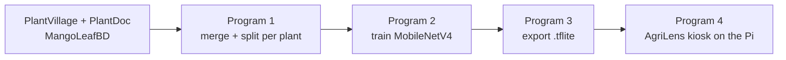

# AgriLens: offline plant-leaf diagnosis for farmers

**Authors:** Sayantan Roy · Shreyance Engineer · Ryan Sahu · Yatharth Sharma
**Status:** private repository · **License:** code and docs under [CC BY-NC 4.0](LICENSE); datasets and trained models are **not** covered (see [Licensing](#licensing))

AgriLens is a touchscreen kiosk that runs on a Raspberry Pi. A farmer picks a plant, photographs one
leaf with a USB webcam, and gets a probable diagnosis, a confidence score, the likely cause and
plain-language advice on how to treat the plant. Everything runs on the device with no internet.

One small **MobileNetV4** model is trained **per plant** (not one big model for everything) and
exported to TFLite. The Pi app loads the model for whichever plant the farmer chooses.

> Status: working prototype. See [Known limitations](#known-limitations) before relying on any result.

---

## How it works



Programs 1 to 3 run in **Google Colab**. Program 4 runs on the **Raspberry Pi**.

## Repository contents

| File | Runs on | What it does |
|---|---|---|
| `program1_build_datasets.py` | Colab | Builds merged per-plant datasets for **tomato** and **potato** |
| `program2_train_mobilenetv4.py` | Colab (GPU) | Trains one MobileNetV4 per plant folder found |
| `program3_export_tflite.py` | Colab | Converts the checkpoints to `.tflite` with litert-torch |
| `program1_other_plants.py` | Colab | Same as Program 1 for **apple, corn, grape, bell pepper** |
| `program2_other_plants.py` | Colab (GPU) | Same as Program 2 for those four plants (settings block at the top) |
| `program3_other_plants.py` | Colab | Same as Program 3 for those four plants, one zip download |
| `mango_train_export.py` | Colab (GPU) | Single script: download MangoLeafBD, train, export |
| `program4_agrilens.py` | Raspberry Pi | The kiosk app (also installs itself to start at boot) |

## Plants and classes

Classes come from the dataset-merge rules below. Check each plant's `dataset_report.json` for the exact
folders that were matched on your copy of the data.

| Plant | Classes | Source |
|---|---|---|
| Tomato | early blight, late blight, septoria leaf spot, bacterial spot, leaf mold, mosaic virus, yellow leaf curl virus, spider mites, healthy | PlantDoc + PlantVillage |
| Potato | early blight, late blight (healthy only if PlantDoc has a matching folder) | PlantDoc + PlantVillage |
| Apple | apple scab, cedar apple rust, healthy | PlantDoc + PlantVillage |
| Corn | gray leaf spot, common rust, northern leaf blight (**no healthy class**) | PlantDoc + PlantVillage |
| Grape | black rot, healthy | PlantDoc + PlantVillage |
| Bell pepper | bacterial spot, healthy | PlantDoc + PlantVillage |
| Mango | anthracnose, bacterial canker, cutting weevil, die back, gall midge, healthy, powdery mildew, sooty mould | MangoLeafBD |

Blueberry, cherry, peach, raspberry, soybean, squash and strawberry are skipped: after applying the
rules they would have only one class (a healthy leaf), so no classifier can be trained.

## Dataset merge rules (Program 1)

PlantVillage images are clean lab photos; PlantDoc images are real-world photos. For each plant:

1. If the two datasets share **no** classes, use **PlantDoc only**.
2. If they share some classes, **merge** PlantDoc + PlantVillage for those classes.
3. PlantVillage-only classes are **thrown out**. PlantDoc-only classes are **kept**.
4. If the plant is not in PlantDoc, or fewer than two classes remain, it is skipped.

**Split policy:** PlantDoc's test split is the test set (real-world photos only). PlantDoc train plus
PlantVillage is split into train and validation. PlantVillage is capped at 1000 images per class so the
lab photos do not swamp the real-world ones.

PlantDoc folder names and three class pairings are assumptions (bell pepper "leaf spot" = bacterial spot,
corn "leaf blight" = northern leaf blight, apple "rust" = cedar apple rust). If a class shows
`PD only` instead of `PD+PV` in the Program 1 output, the folder names on your copy differ; edit
`PLANT_CONFIG` at the top of the script.

## Model and training (Program 2)

- Backbone: `mobilenetv4_conv_small.e2400_r224_in1k` from [timm](https://github.com/huggingface/pytorch-image-models), ImageNet pretrained, 224 x 224 input.
- Fine-tuned end to end with AdamW (lower learning rate for the backbone), label smoothing 0.1, cosine schedule, mixed precision.
- Augmentation: random resized crop, flips, rotation, colour jitter.
- Training stops when validation accuracy reaches the target (default 96%), after a minimum number of
  epochs, or by early stopping if it stops improving. The best checkpoint is kept.
- Validation accuracy includes PlantVillage's easy lab images. **Use the printed TEST accuracy** (PlantDoc real-world photos) as the honest number.

### Results

Fill these in from your own runs.

| Plant | Val acc | Test acc | Notes |
|---|---|---|---|
| Tomato | TODO | TODO | |
| Potato | TODO | TODO | |
| Apple | TODO | TODO | |
| Corn | TODO | TODO | |
| Grape | TODO | TODO | |
| Bell pepper | TODO | TODO | |
| Mango | TODO | TODO | test set is optimistic, see limitations |

## Export format (Program 3)

Models are converted with [LiteRT Torch](https://github.com/google-ai-edge/litert-torch)
(`litert_torch.convert(...)`, `.export(...)`). Preprocessing is baked into the model:

- Input: `float32 [1, 3, 224, 224]`, RGB, channels first, pixel values scaled **0 to 1**
- Output: `float32 [1, num_classes]`, softmax probabilities
- Class order: line order of the matching `<plant>_labels.txt`

Each plant ships as `<plant>_mobilenetv4.tflite` plus `<plant>_labels.txt`. Keep the pair together.

## Running the Colab programs

1. Open a new Colab notebook. For training, use a GPU runtime (Runtime > Change runtime type > T4).
2. Paste a program into a cell and run it. The scripts install their own dependencies and send
   their results to your browser as downloads.
3. Order: Program 1 (data), then 2 (train), then 3 (export), all in the same session if you can.
   In a new session, the next program asks once for the zip files the previous one downloaded.
4. If Program 3 says the session must restart, use Runtime > Restart session and run it again; files
   in `/content` are kept.

Edit the settings block at the top of the `*_other_plants.py` scripts (`PLANTS`, `EPOCHS`, `TARGET_ACC`, ...).
`mango_train_export.py` logs in to Kaggle with `KAGGLE_USERNAME` / `KAGGLE_KEY` (environment or Colab Secrets,
or it asks for them) and falls back to a Hugging Face copy of the dataset.

## The Raspberry Pi app (Program 4)

### Hardware used

Raspberry Pi 5 (Pi 4 should also work), 7-inch touchscreen, USB webcam (HP w200 tested; it is
fixed-focus, see limitations), optional USB keyboard for admin use.

### Setup (once)

```bash
mkdir -p ~/agrilens/models && cd ~/agrilens
# copy program4_agrilens.py here, and every <plant>_mobilenetv4.tflite + <plant>_labels.txt into models/
python3 program4_agrilens.py --install     # installs dependencies, sets the exit password, enables start-at-boot
sudo raspi-config                           # System Options > Boot / Auto Login > Desktop Autologin; Display > Screen Blanking > Off
sudo reboot
```

If `pip` is blocked on Raspberry Pi OS, the script builds its own `.venv`. It also needs `python3-tk`
(`sudo apt install python3-tk python3-pil.imagetk`). Re-run `--install` after updating the script.

### Using it

1. Tap **Choose Plant** and tap your plant. New models dropped into `models/` appear automatically.
2. Hold one leaf in front of the camera so it fills the picture and tap **Capture**.
3. The photo is quality-checked first (too dark, too bright, blurry, or no leaf). A bad photo is
   **not** diagnosed; the app explains how to retake it. Otherwise the diagnosis appears automatically.
4. **Diagnose** re-runs the result and **Clear** returns to the live camera.

Results below 50% confidence show "Not sure" instead of a guess.

### Stopping the app (admin only)

> Remove this section before sharing the repository publicly.

The app is a kiosk and cannot be closed normally. Either:

- tap the small unlabeled button in the top-right corner **7 times**, or
- press **Ctrl + Alt + Shift + Q** on a USB keyboard,

then enter the password (typed or on-screen). Three wrong attempts lock the screen for 30 seconds.
Change the password with `python3 program4_agrilens.py --set-password`.
Useful flags: `--windowed` (test in a normal window over VNC), `--hide-cursor`, `--camera N`, `--uninstall`.

### Files the app creates

| File | Purpose |
|---|---|
| `plants.json` | Plant names shown on the buttons, mapped to model + labels files. Edit `name` to rename (any language); leave `key` alone. |
| `disease_suggestions.json` | Cause and advice text per plant and disease. Edit freely; new defaults are merged in without overwriting your edits. |
| `config.json` | Password hash, last plant, `min_confidence`, photo-quality thresholds |
| `captures/` | Every photo taken |
| `diagnosis_log.csv` | Time, plant, result, confidence and photo-quality numbers (useful for tuning) |

Settings you may want to change are in the block near the top of `program4_agrilens.py`
(`CAMERA_WIDTH/HEIGHT`, `KEYBOARD_EXIT_COMBO`, `KEYBOARD_COMBO_NEEDS_PASSWORD`).

## Known limitations

- **Domain gap.** The models learned from lab and curated photos. Accuracy on field photos from your
  own webcam is lower. Plain background, even daylight and one leaf filling the frame help a lot.
  Adding your own photos from the real camera to training data is the biggest improvement available.
- **MangoLeafBD has near-duplicates.** Published papers describe about 1,800 distinct leaves, with the rest
  constructed copies, so a random split leaks and the reported mango accuracy is optimistic.
- **Corn has no healthy class** under the merge rules, so a healthy corn leaf will be labelled as a disease.
- **Closed set.** A model can only answer with the classes it was trained on. A wrong plant choice or a
  non-leaf can still produce a confident-looking answer; the quality and confidence checks reduce this but do not remove it.
- **Fixed-focus webcams** (HP w200 is sharp only from about 60 cm) blur close-up leaves.
- **Photo-quality thresholds are starting values** that have not been tuned on real photos. Tune them in
  `config.json` using `diagnosis_log.csv`.
- **Not benchmarked** for speed or accuracy on the Pi yet.
- **Advice is general guidance**, not agronomic advice. It names no chemical doses; users are told to check with
  their local agriculture office.
- **The password is not a security boundary.** Someone with SSH access or a keyboard on a full desktop can still stop the app.

## Troubleshooting

| Problem | Try |
|---|---|
| "Camera not found" | Check the cable; try `--camera 1`; run `ls /dev/video*` |
| Preview is slow at 1280x720 | Normal for uncompressed USB 2.0 webcams; lower `CAMERA_WIDTH/HEIGHT` |
| Plant missing from Choose Plant | The `.tflite` needs a labels file next to it (`<plant>_labels.txt`) |
| "Model has N outputs but labels file has M lines" | Labels file does not match the model; re-export both together |
| App does not start at boot | `cat ~/.config/autostart/agrilens.desktop`; confirm Desktop Autologin is on; re-run `--install` |
| Keyboard combo does nothing | The desktop may be intercepting it; change `KEYBOARD_EXIT_COMBO` |

## Contributions

### Authors

| Author | Contribution |
|---|---|
| Sayantan Roy | Developed the program UI and interface with the help of Claude. |
| Shreyance Engineer | Helped throughout the project and supplied parts for the robot. |
| Ryan Sahu | Helped in the project for the AI development. |
| Yatharth Sharma | Helped in the project for the AI development. |
| Faiyaz Engineer (The Dad of Shreyance) | Helped the rest of the team members learn about data science and motivated the rest of the team to work harder and helped whenever needed. |

The authors defined the project and its requirements, chose the datasets and the merge policy, ran and tested the code on Google Colab and Raspberry Pi hardware, and gave the feedback that shaped each revision.

### AI assistance (Claude, Anthropic)

Claude, an AI assistant made by Anthropic, was used throughout development, under the authors' direction. Its contributions:

- wrote and iterated the code of all eight scripts listed in [Repository contents](#repository-contents): the dataset-merge logic, the training loop, the LiteRT Torch export with accuracy checks, and the Raspberry Pi kiosk (touch UI, threaded camera, photo-quality gate, plant registry, on-screen keyboard and password lock, keyboard admin combo, start-at-boot setup)
- researched and cross-checked the datasets' structure, licences and citations (see the next section) and flagged the licensing and data-leakage risks noted in this document
- wrote the first draft of the disease-advice texts in `disease_suggestions.json`
- drafted this README and the licence notice

Claude did not run training or hardware tests; all results come from the authors' runs. The authors remain responsible for reviewing, testing and validating all code and text before any real-world use.

## Dataset credits and citations

We thank the creators of the datasets below, which made this project possible. Please cite them if you use this work.

| Dataset | Creators | Licence as published | Used for |
|---|---|---|---|
| **PlantDoc** | Davinder Singh, Naman Jain, Pranjali Jain, Pratik Kayal, Sudhakar Kumawat, Nipun Batra | CC BY 4.0 (per its GitHub repository) | Real-world leaf photos for tomato, potato, apple, corn, grape and pepper; **all test data** |
| **PlantVillage** | David P. Hughes, Marcel Salathé (Penn State, EPFL); image-based detection work by Sharada P. Mohanty, Hughes, Salathé | **Inconsistent between sources**, see [Licensing](#licensing) | Clean lab images, merged into the same plants for training |
| **MangoLeafBD** | Sawkat Ali, Muhammad Ibrahim, Sarder Iftekhar Ahmed, Md. Nadim, Mizanur Rahman, Maria Mehjabin Shejunti, Taskeed Jabid (Dhaka University; East West University) | **CC BY-NC 3.0** (per its Mendeley Data page) | All mango training data |

Sources: PlantDoc [github.com/pratikkayal/PlantDoc-Dataset](https://github.com/pratikkayal/PlantDoc-Dataset) · PlantVillage [github.com/spMohanty/PlantVillage-Dataset](https://github.com/spMohanty/PlantVillage-Dataset) · MangoLeafBD [doi.org/10.17632/hxsnvwty3r.1](https://doi.org/10.17632/hxsnvwty3r.1). We obtained MangoLeafBD from the Kaggle upload by `aryashah2k` ([kaggle.com/datasets/aryashah2k/mango-leaf-disease-dataset](https://www.kaggle.com/datasets/aryashah2k/mango-leaf-disease-dataset)); the licence above is the one on the original Mendeley record.

```bibtex
@inproceedings{10.1145/3371158.3371196,
  title     = {PlantDoc: A Dataset for Visual Plant Disease Detection},
  author    = {Singh, Davinder and Jain, Naman and Jain, Pranjali and Kayal, Pratik and Kumawat, Sudhakar and Batra, Nipun},
  booktitle = {Proceedings of the 7th ACM IKDD CoDS and 25th COMAD},
  pages     = {249--253},
  year      = {2020},
  publisher = {Association for Computing Machinery},
  address   = {New York, NY, USA},
  doi       = {10.1145/3371158.3371196}
}

@article{DBLP:journals/corr/HughesS15,
  title   = {An open access repository of images on plant health to enable the development of mobile disease diagnostics},
  author  = {Hughes, David P. and Salath{\'e}, Marcel},
  journal = {CoRR},
  volume  = {abs/1511.08060},
  year    = {2015},
  url     = {http://arxiv.org/abs/1511.08060}
}

@article{Mohanty_Hughes_Salathe_2016,
  title   = {Using deep learning for image-based plant disease detection},
  author  = {Mohanty, Sharada P. and Hughes, David P. and Salath{\'e}, Marcel},
  journal = {Frontiers in Plant Science},
  volume  = {7},
  year    = {2016},
  doi     = {10.3389/fpls.2016.01419}
}

@misc{mangoleafbd2022,
  title     = {MangoLeafBD Dataset},
  author    = {Ali, Sawkat and Ibrahim, Muhammad and Ahmed, Sarder Iftekhar and Nadim, Md. and Rahman, Mizanur and Shejunti, Maria Mehjabin and Jabid, Taskeed},
  year      = {2022},
  publisher = {Mendeley Data},
  version   = {1},
  doi       = {10.17632/hxsnvwty3r.1}
}
```

Author lists are as shown on the sources above; check each dataset page for its latest recommended citation.

### Model and software

MobileNetV4 (Qin et al., "MobileNetV4: Universal Models for the Mobile Ecosystem", ECCV 2024, arXiv:2404.10518) via [timm](https://github.com/huggingface/pytorch-image-models) (Ross Wightman), PyTorch, [LiteRT Torch](https://github.com/google-ai-edge/litert-torch) (`litert-torch`) and `ai-edge-litert` (Google AI Edge), OpenCV, NumPy, Pillow, kagglehub, Hugging Face `datasets`, and Python's Tkinter. Each project keeps its own licence.

## Licensing

The **source code, scripts, configuration files and documentation** written by the authors are licensed under **Creative Commons Attribution-NonCommercial 4.0 International (CC BY-NC 4.0)**; see [`LICENSE`](LICENSE). In short: others may copy and adapt this work for **non-commercial** purposes if they give credit, link the licence and mark their changes.

**Not covered by that licence:**

- **Datasets.** They keep their own licences (previous section).
- **Trained models** (`.pth`, `.tflite`). Models inherit obligations from their training data:
  - The **mango model** was trained on a dataset published as **CC BY-NC 3.0**, so it must stay **non-commercial**.
  - **PlantVillage's licence is reported inconsistently:** several mirrors and derived datasets say CC0 1.0, while a summary of the original paper describes CC BY-SA 3.0 with a clause extending the licence to algorithms trained on the data. **Check the original source and take advice before distributing** any model trained on PlantVillage images (tomato, potato, apple, corn, grape, pepper). If share-alike terms apply, they may conflict with an NC-only licence on those models.
  - Weights pretrained on **ImageNet** (loaded through timm) have their own usage terms; check them before any commercial use.
- **Third-party libraries**, under their own licences.

Other things to know:

- Creative Commons itself does not recommend its licences for software, because they have no patent grant and do not address source-code distribution. If you later need a stronger software licence, options include PolyForm Noncommercial or a custom licence agreed by all four authors.
- A licence sets terms for people who receive the work; it does not technically prevent copying. While the repository is private, access control is the real protection. Once a copy has been shared under CC BY-NC, that grant cannot be withdrawn for that copy.
- All four authors are co-owners of the original work, so agree on licensing changes together. The extent of copyright in AI-generated code can be uncertain in some countries; keep the commit history as a record of human authorship and review.

## Disclaimer

AgriLens gives probabilistic suggestions from a photograph. It is **not** a substitute for an agronomist or the local agriculture office. Do not apply chemicals based only on this tool; follow the product label and local guidance. The software is provided "as is", without warranty of any kind.

## Citing this project

> Roy, S., Engineer, S., Engineer, F., Sahu, R., Sharma, Y. (2026). *AgriLens: offline plant-leaf disease diagnosis on Raspberry Pi.* [Institution / repository URL to be added.]

**Contact:** [add contact email or institution]
